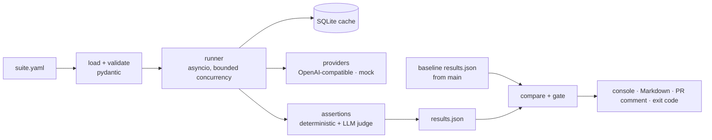

# driftgate

[](https://github.com/Muddasirr/driftgate/actions/workflows/ci.yml)
[](https://github.com/Muddasirr/driftgate/actions/workflows/eval-gate.yml)
[](pyproject.toml)
[](LICENSE)

**Catch LLM quality drift before it merges.** Write eval cases for your prompts and agents in YAML, and driftgate runs them in CI, compares the results with your main branch, and blocks the pull request if anything that used to pass now fails, or if cost or latency jumps.

A prompt tweak, a model upgrade or a new tool description can quietly break behaviour that worked yesterday. Unit tests don't catch it, and nobody re-reads 50 transcripts by hand. driftgate turns "the agent should look the caller up before creating a record" into a check that runs on every PR.

## What it looks like on a pull request

This is real driftgate output from the [quickstart suite](examples/quickstart/suite.yaml) after changing the bot to promise refunds:

> ## driftgate · quickstart · ❌ failed
>
> - 1 regression(s), max allowed 0
>
> | Provider | Pass rate | Cost | p95 latency |
> |---|---|---|---|
> | `mock-support-bot` | 2/3 (67%) (-33 pp) | $0.000140 (+87.6%) | 5 ms |
>
> ### Regressions (1)
>
> | Case | Provider | First failure |
> |---|---|---|
> | `refund-request` | `mock-support-bot` | not_contains: must not contain 'I will refund' |

## Features

- **One YAML file per suite:** system prompt, tools, models and cases, validated before anything runs, so a typo costs milliseconds, not a paid run.
- **Agent-aware assertions:** check which **tool** the model calls and with what **arguments** (exact or regex), replay earlier tool calls and tool results in the conversation, and assert a tool is *not* called.
- **Baseline diffs, not just scores:** every case is classified as regressed, fixed, still failing, new or removed, and the gate fails on regressions, a pass-rate floor, or cost and p95-latency budgets.
- **Any OpenAI-compatible model:** OpenAI, Groq, Together, Fireworks, vLLM, Ollama. Run several in one suite to compare them side by side.
- **Cheap and reproducible:** responses are cached in SQLite by request hash, so re-running an unchanged suite is free. Retries with exponential backoff honour `Retry-After`.
- **LLM-as-judge** for things string checks can't capture, with a rubric and a minimum score.
- **Flakiness shows up:** `repeat: N` runs a case N times, and it passes only if every run passes.
- **GitHub Action included:** fetches the baseline from your default branch's last run, posts one PR comment and keeps it updated, and writes the job summary.

## Quickstart

```bash
pip install "git+https://github.com/Muddasirr/driftgate"

# Try the full loop offline (mock provider, no API key):
git clone https://github.com/Muddasirr/driftgate && cd driftgate
driftgate run examples/quickstart/suite.yaml --out baseline.json
driftgate run examples/quickstart/suite.yaml --baseline baseline.json

# Start your own suite:
driftgate init my-suite.yaml        # example suite for an OpenAI model
export OPENAI_API_KEY=...
driftgate run my-suite.yaml
```

Exit codes: `0` gate passed, `1` gate failed, `2` invalid suite or setup error.

## Writing a suite

```yaml
name: support-bot
system: file://prompt.md          # or inline text
tools: file://tools.json          # OpenAI tool schemas, optional

providers:
  - id: gpt-4o-mini
    type: openai
    model: gpt-4o-mini
    api_key_env: OPENAI_API_KEY
    pricing: {input_per_mtok: 0.15, output_per_mtok: 0.60}
  - id: llama-3.3-70b
    type: openai
    base_url: https://api.groq.com/openai/v1
    model: llama-3.3-70b-versatile
    api_key_env: GROQ_API_KEY

judge: gpt-4o-mini                # default provider for llm_judge

defaults: {temperature: 0, max_tokens: 512, repeat: 1, concurrency: 4}

thresholds:
  min_pass_rate: 0.9              # per provider
  max_regressions: 0              # vs. baseline
  max_cost_increase_pct: 25
  max_p95_latency_increase_pct: 50

cases:
  - id: order-lookup
    input: Where is order A-1042?
    assert:
      - {type: tool_call, name: get_order_status, args: {order_id: {regex: "^A-\\d+$"}}}

  - id: no-duplicate-record             # replay an agent's earlier steps
    messages:
      - {role: user, content: "I'm Jane, 555 123 4567"}
      - role: assistant
        tool_calls: [{id: c1, name: lookup_customer, arguments: {phone: "5551234567"}}]
      - {role: tool, tool_call_id: c1, content: '{"found": true, "customer_id": "c-9"}'}
    assert:
      - {type: no_tool_call, name: create_customer}
      - {type: llm_judge, rubric: Offers to update the existing record instead of creating one.}
```

### Assertions

| Type | Passes when |
|---|---|
| `contains` / `not_contains` | the text includes (or doesn't include) `value`. Case-insensitive unless `case_sensitive: true`. |
| `equals` | the text equals `value` (whitespace stripped unless `strip: false`) |
| `regex` | `pattern` matches anywhere in the text |
| `json_valid` | the text parses as JSON (Markdown code fences are tolerated) |
| `json_schema` | the text parses and validates against `schema` |
| `tool_call` | the model calls `name`. `args` match exactly or by `{regex: ...}`. `position: first` requires it to be the first call. |
| `no_tool_call` | the model doesn't call `name` (or any tool if `name` is omitted) |
| `max_latency_ms` | the response took at most `value` ms (skipped for cached responses) |
| `max_cost_usd` | the call cost at most `value` (needs `pricing` on the provider) |
| `llm_judge` | the judge model scores the output at least `min_score` (default 4) out of 5 against `rubric` |

Run `driftgate run --help` to filter by `--provider`, `--tag` or `--case`, and to set `--concurrency`, `--no-cache`, `--markdown` and `--out`.

## In CI

```yaml
# .github/workflows/evals.yml
name: Evals
on:
  push: {branches: [main]}
  pull_request:

permissions:
  contents: read
  actions: read          # download the baseline artifact
  pull-requests: write   # post the report comment

jobs:
  evals:
    runs-on: ubuntu-latest
    steps:
      - uses: actions/checkout@v4
      - uses: Muddasirr/driftgate@v0.1.0
        with:
          suite: evals/suite.yaml
        env:
          OPENAI_API_KEY: ${{ secrets.OPENAI_API_KEY }}
```

On `main`, each run uploads its results as an artifact, which becomes the baseline. On a pull request, the action downloads the latest baseline, runs the suite, posts or updates one comment, and fails the check if the gate fails. Set `fail-on-gate: "false"` to report without blocking. This repository runs its own action on every PR ([eval-gate.yml](.github/workflows/eval-gate.yml)).

## Case study: a phone intake agent

[`examples/voice-intake`](examples/voice-intake) tests the real system prompt and tool schemas of [voice-patient-intake](https://github.com/Muddasirr/voice-patient-intake), a phone agent that registers patients and writes to a database through tool calls. Wrong tool calls there mean duplicate or wrong patient records, so most of its 12 cases check tool behaviour:

- looks the caller up as soon as it has a 10-digit number, and doesn't for a 7-digit one
- offers to update, rather than create a duplicate, when the lookup finds a record (replayed tool result)
- calls `create_patient` only after an explicit "yes" to the read-back, with normalised values (`1990-03-14`, `TX`, digits-only phone)
- never saves with a missing required field, and re-asks for a future date of birth
- switches to Spanish on request, asks one or two things at a time, keeps turns short and cheap

```bash
export GROQ_API_KEY=...
driftgate run examples/voice-intake/suite.yaml --provider llama-3.3-70b
```

> **TODO(Muddasir):** run the case study against llama-3.3-70b and gpt-4o-mini and paste the results table here, with one finding (which rule each model breaks, and what prompt change fixed it).

## How it works



### Design decisions

- **The results file is the baseline.** There's no server or database to run: a JSON file (versioned schema) is stored as a CI artifact and compared on the next PR. That keeps adoption to a single workflow file.
- **A case passes only if every repeat passes.** Averaging hides flakiness, and a prompt that fails one time in three is a bug.
- **Cached responses skip latency checks** instead of reporting 0 ms, so a cache hit can never make a slow model look fast.
- **The judge never sees the system prompt.** It grades the behaviour against the rubric, not whether the output matches the instructions it was given.
- **Errors are results.** A provider failure becomes a failed attempt with the error recorded, so one rate-limited call doesn't abort a 200-case run.

### Compared with other tools

[promptfoo](https://github.com/promptfoo/promptfoo) and [DeepEval](https://github.com/confident-ai/deepeval) are broader evaluation frameworks with many more metrics and integrations. driftgate is deliberately narrow: a small, typed Python package focused on one job, a merge gate with baseline diffs for prompts and tool-calling agents.

## Roadmap

- Native Anthropic and Gemini providers (today they work through OpenAI-compatible gateways)
- Variables and templating across cases
- HTML report with side-by-side outputs for regressions
- Statistical gating for non-zero temperature (confidence intervals over repeats)

## Development

```bash
python -m venv .venv && source .venv/bin/activate
pip install -e ".[dev]"
pytest --cov=driftgate      # 74 tests, no network or API keys needed
ruff check . && ruff format --check . && mypy
```

See [CONTRIBUTING.md](CONTRIBUTING.md). Licensed under [MIT](LICENSE).
